# Tryptify

> A native Android hi-fi music player: a C++17 DSP console, headphone AutoEQ from real measurements, bit-perfect USB-DAC output, and a player you can watch.

[](https://github.com/tryptz/Tryptify/releases)
[](https://github.com/tryptz/Tryptify/releases/latest)
-3DDC84?logo=android&logoColor=white)


<p align="center">
  <a href="https://github.com/tryptz/Tryptify/releases/latest/download/tryptify.apk"><b>⬇ Download the latest APK</b></a>
  &nbsp;·&nbsp;
  <a href="https://github.com/tryptz/Tryptify/releases/latest">Release notes</a>
  &nbsp;·&nbsp;
  <a href="https://tryptify.com">tryptify.com</a>
  <br>
  <sub>Android 8.0+ (liquid glass, the CRT effect and god rays need Android 13) · formerly <b>MonoTrypT</b>, existing installs upgrade in place</sub>
</p>

<table>
  <tr>
    <td colspan="3" align="center">
      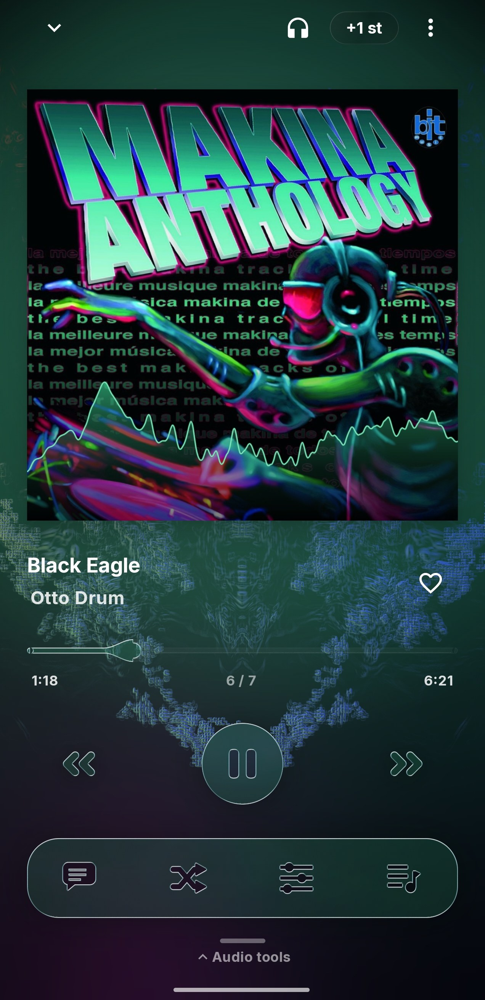
      <br>
      <b>Glass spectrum</b>: TRYPTIFY SCREENSHOTS
    </td>
  </tr>
  <tr>
    <td width="33%" valign="top">
      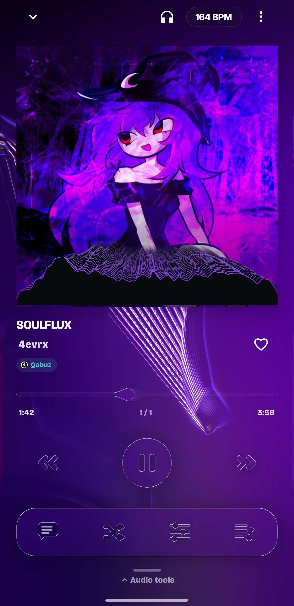
      <b>Ridgeline spectrum</b> over the cover, with the ambient visualizer.
    </td>
    <td width="33%" valign="top">
      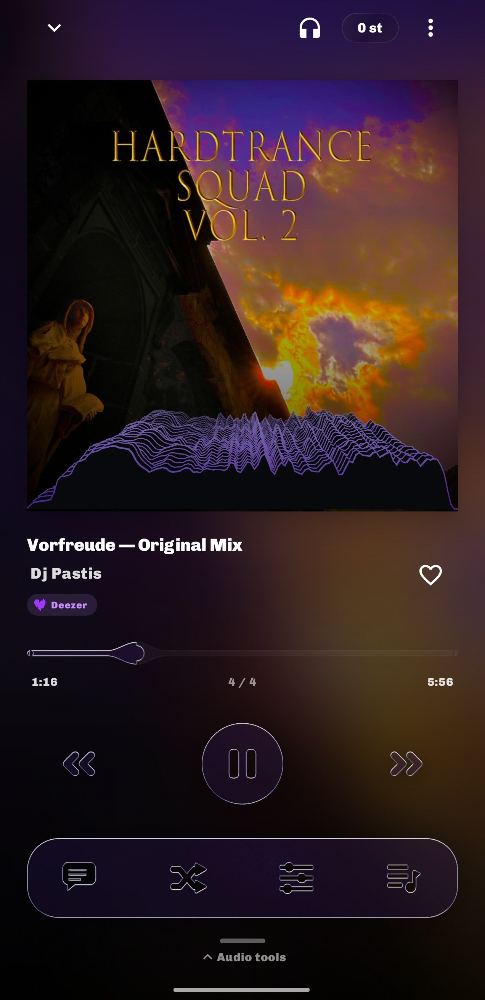
      <b>Waterfall spectrum</b> on a streamed track.
    </td>
    <td width="33%" valign="top">
      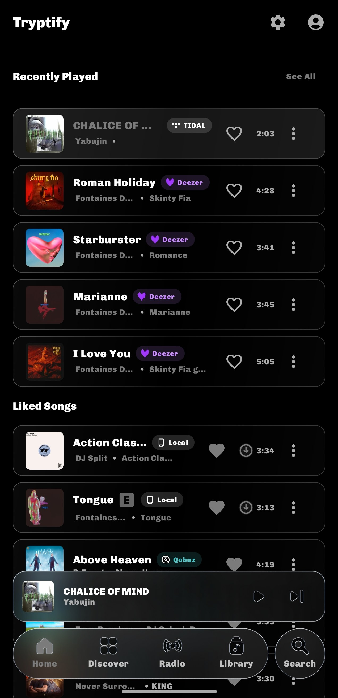
      <b>Home</b> with source pills, the mini player and the glass nav bar.
    </td>
  </tr>
  <tr>
    <td width="33%" valign="top">
      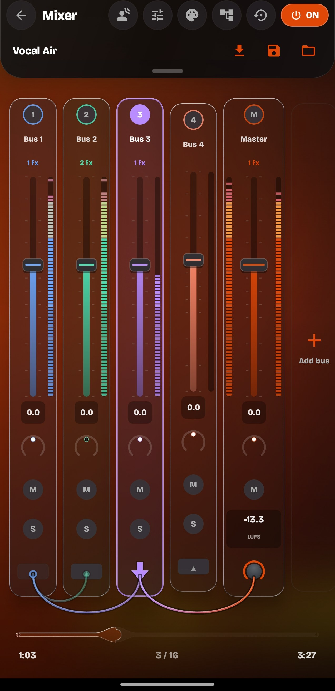
      <b>Mixer</b> buses with faders, meters, routing and LUFS.
    </td>
    <td width="33%" valign="top">
      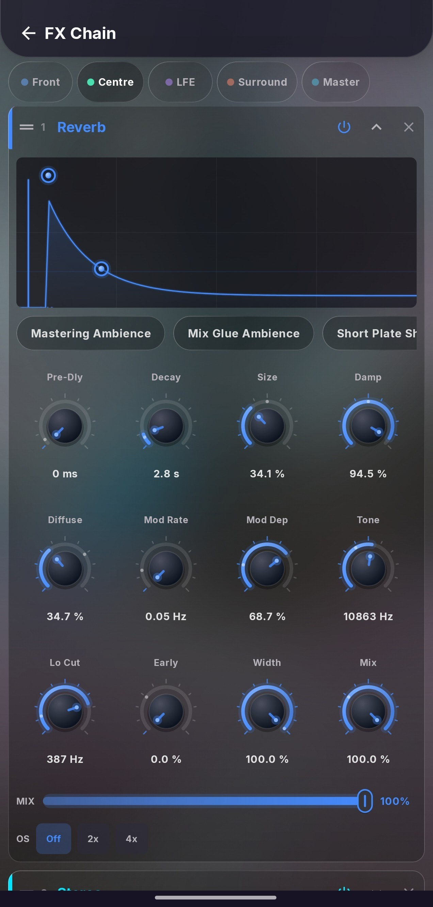
      <b>FX Chain</b>: a reverb with its decay graph and presets.
    </td>
    <td width="33%" valign="top">
      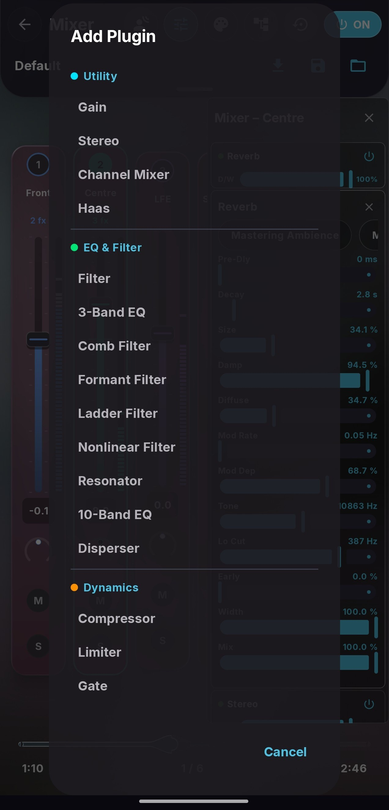
      <b>Add Plugin</b>: the processors by category.
    </td>
  </tr>
  <tr>
    <td width="33%" valign="top">
      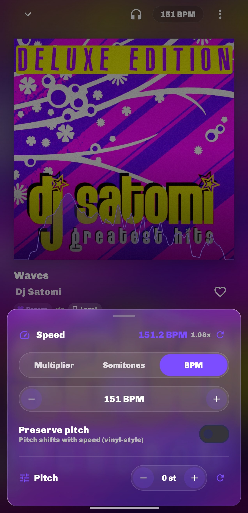
      <b>Speed and pitch</b> by multiplier, semitones or BPM.
    </td>
    <td width="33%" valign="top">
      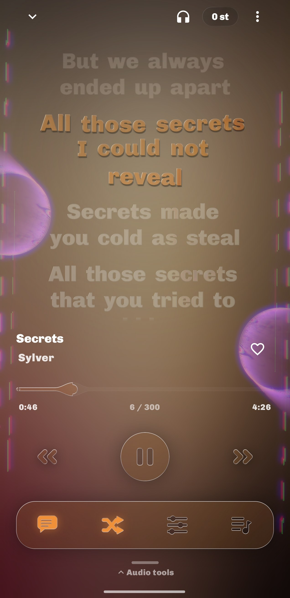
      <b>Lyrics</b>, synced line by line.
    </td>
    <td width="33%" valign="top">
      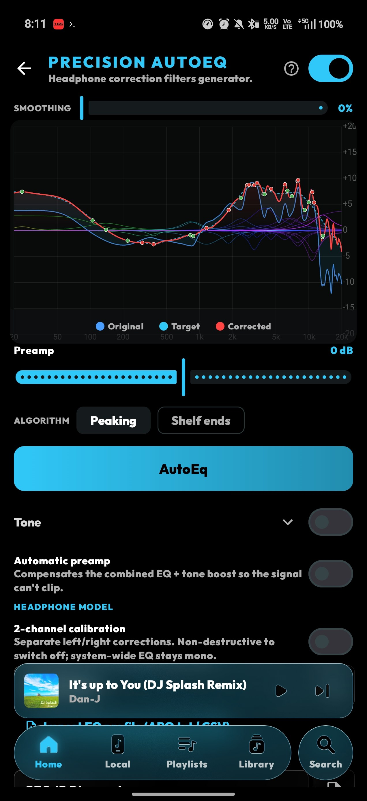
      <b>AutoEQ</b>: headphone correction from measurements.
    </td>
  </tr>
</table>

## What's in it

| | |
| --- | --- |
| **Every source in one player** | Local FLAC, ALAC, WAV, MP3, AAC and Opus, plus TIDAL, Qobuz and Deezer from servers you add, your own Navidrome or other Subsonic server, and Tryptify Cloud. |
| **Tryptify Cloud** | Your music stored for you, lossless files kept as uploaded, played like your own server. From $0.99 a month for 10 GB up to 10 TB, with a 7-day free trial. |
| **A spectrum you can read** | A C++ waterfall from a 16K-point FFT, in six styles, up to 120 fps. |
| **DSP mixing console** | A C++17 engine with up to 48 buses, 36 processors and EBU R128 meters. |
| **Headphone AutoEQ** | Correction from 4,000+ measurements against 10 targets, with target pills and a filter editor under the graph. |
| **Bit-perfect USB DAC** | Its own UAC1/UAC2 driver writes straight to the DAC, Apple's USB-C adapter included. |
| **Speed, pitch, tempo** | 0.25× to 3.0×, by multiplier, semitones or BPM, with two pitch engines. |
| **MilkDrop visualizer** | projectM with 9,795 presets, each tested before it ships. |
| **Trypt Mania** | A StepMania-style rhythm game on your own songs, charted for you, with packs, rooms and a live scoreboard. |
| **Bluetooth sync** | Measure your headphones' delay once; lyrics, visuals and the game all wait for it. |
| **Music links** | Sliders and mixer knobs that move with the kick, vocals, snare or hi-hats. |
| **Theme Store** | Share or try a whole look, CRT effect included, in the store or by code. |
| **CRT effect** | The whole app or the lyrics through an old TV, with curve, zoom and presets. |
| **Typography** | Every text style with its own font, weight, size and width; eleven fonts built in. |
| **Library galaxy** | Your artists as stars, albums as planets and tracks as moons, offline. |
| **Tryptify Connect** | Your phone and tryptify.com see each other: move the music between them at the same second, or steer one from the other. |
| **Listening parties** | Hear the same moment of the same song with friends, in the app or a browser, with a shared queue, chat and vote skip. |
| **Web player** | [tryptify.com/player](https://tryptify.com/player) plays your files, your server, Tryptify Cloud and TrypT HiFi through the app's AutoEQ. |
| **Eight languages** | English, 简体中文, 日本語, Français, Español, Türkçe, Deutsch and Italiano. |
| **Everywhere else** | Widget, Android Auto, Discord, Last.fm, ListenBrainz, downloads and account sync. |

## How the sound flows

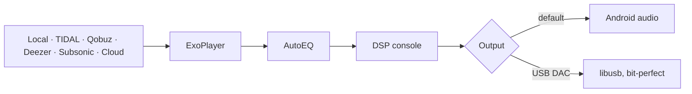

## Building

Needs Android Studio, JDK 17, and the NDK and CMake from the SDK Manager. Clone recursively for the submodules.

```bash
git clone --recursive https://github.com/tryptz/Tryptify.git
./gradlew assembleDebug
./gradlew :app:testDebugUnitTest
```

Contributors and coding agents start at [`AGENTS.md`](AGENTS.md). What changed: [release notes](docs/releases/1.9.5.md) and [CHANGELOG](CHANGELOG.md).

## Licences

- **The app, and everything else in this repository unless said otherwise:**
  [GPL-3.0-or-later](LICENSE).
- **The Tryptify Cloud server** ([`server/cloud/`](server/cloud/)):
  [PolyForm Noncommercial 1.0.0](server/cloud/LICENSE.md). You may read,
  run and change it for noncommercial purposes; running it as a paid service
  needs the author's permission.
- **Third-party parts keep their own licences:** projectM (LGPL-2.1), libusb
  (LGPL-2.1), the Cavern port (its own terms, `app/src/main/cpp/atmos/cavern/NOTICE.md`),
  StepMania art (MIT, next to the art), fonts (OFL-1.1,
  `app/src/main/assets/fonts/LICENSES.txt`) and the rest named in their
  folders.

Built by **[tryptz](https://github.com/tryptz)**.
